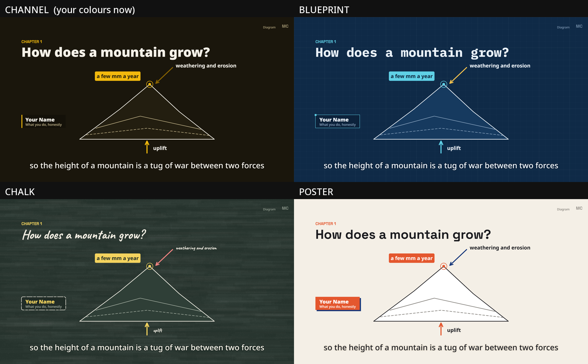

# Explainer Studio

**English** · [中文](README.zh-CN.md)

A Claude Code plugin for making explainer videos for YouTube, where Claude does the work of the whole crew and you
direct. You write no code. You pick the topic, record your voice and your on-camera clips, watch the previews and
approve each step.

It was built with and for the Mandarin earth-science channel 金釘子 GoldenSpike and then opened up for any topic and
language. Every rule in it comes from something that went wrong, or right, on a real video. This is version 2: the
studio pipeline as it runs today (version 0.1, the first public release, stays available as the tag `v0.1.0`).

## Install and start: one prompt

Open an empty folder for your channel in Claude Code (terminal, desktop app or IDE extension), paste this, and fill
in the last line:

```text
Install the Explainer Studio plugin and set up my video studio.
1. In the terminal run:  claude plugin marketplace add yuxuanteh/explainer-studio
   then:                 claude plugin install explainer-studio@explainer-studio
2. Find the installed plugin folder (under ~/.claude/plugins), read skills/studio-setup/SKILL.md in it and follow
   it step by step. Start by checking my computer and telling me about how long each step of making a video will
   take on it. Before you install or download anything, tell me what it is for and how big it is, and ask me
   whether I need it.
3. When the studio is ready, run the try-it sample with me, then start my first episode.
My channel: <name>. It explains <topic> to <audience> in <language>. I make <long videos / shorts / both>, <on camera / voice only>.
```

Prefer to type the commands yourself? `/plugin marketplace add yuxuanteh/explainer-studio`, then
`/plugin install explainer-studio@explainer-studio`, then say "set up my studio".

After that, everything is plain sentences: "start a new episode about …", "the recordings for 02 are in raw",
"S05: the label covers my hand, move it left", "make the final".

## What happens at setup

1. **Your computer is checked first.** Processor, memory, graphics card, free disk space, and two short speed
   tests. You get a table of about how long each step will take for a video of your usual length, before you decide
   anything.
2. **Every tool is explained and asked about before it is installed.** If you do not need one, you skip it and
   keep the disk space; you can add it later with one sentence.
3. **A short interview** about your channel: name, audience, language, what you make.
4. **You choose a house style from pictures**: three examples next to the look you have now.
5. **You choose how you want music**: tracks from a library, your own, a score composed by Claude, or none.
6. **A try-it sample**: a four-line short run through the cut and the review page, so you see the tools before you
   record anything.

### The parts, and who can skip them

| Part | What it does for you | You can skip it when | Download |
|---|---|---|---|
| Core | The studio's own Python and ffmpeg: cutting, mixing, subtitles, encoding | never | about 350 MB |
| Fonts | Free fonts for subtitles and on-screen text | never | 3 MB (Latin) to 45 MB (Chinese, Japanese, Korean) |
| Speech recognition (Whisper) | Runs on your own computer and finds the time of every word you said. The automatic first cut, the subtitle timing and the sorting of a recording session all stand on it | your videos have no spoken voice | 3.1 GB (best model), 1.7 GB (medium) or 0.7 GB (small) |
| Animation engine | Animated shots, chapter and end cards, the intro, labels over your camera shots, the style comparison pictures | you only want your camera footage cut, subtitled and mixed. Animation shots then become plain text cards | about 500 MB, plus the free [motion-showreel](https://github.com/ConardLi/garden-skills) plugin |
| Music fitting | Shortens or lengthens a music track on its bar lines so it ends on its own ending | no music, or the programmed score | about 300 MB |
| Programmed score | Music composed by Claude note by note and played through a SoundFont | you use library tracks, your own music, or none | about 40 MB, plus FluidSynth |

A full install is about 4.5 GB; the smallest useful one (core, fonts, the small speech model) is about 1.1 GB.

### How long things take

Measured on the reference laptop (Intel Core Ultra 7 155H, 16 cores, 16 GB memory, no separate graphics card), for
a 6-minute video with a 1-minute short. The setup measures your own computer and scales these numbers.

| Step | Computer time |
|---|---|
| Writing down everything you said (best speech model) | about 9 minutes |
| Automatic first cut and the voice cut | about 3 minutes |
| Animation build at 480p (each later round redraws only the shots you commented on) | about 9 minutes |
| Final 1080p master, the short and the subtitle files | about 13 minutes |

Rough numbers: expect half to double. A graphics card from NVIDIA makes speech recognition about ten times faster;
the medium model is about twice as fast as the best one on any computer. Your own time (recording, watching,
giving notes) is on top, and so is Claude's time writing the script and drawing the animation.

## How a video is made

Seven steps. Claude stops where it says **Stop** and waits for your OK.

1. **Topic.** Checked against your published videos. One video, one idea. **Stop.**
2. **Script and music shortlist.** First the questions a real viewer would ask, then every fact checked against
   sources, then a one-page logic draft (**Stop**), then the narration written in your own way of talking, a
   teaser short with its own question, and a shortlist of music for you to listen to. **Stop.**
3. **Recording kit.** A run sheet that tells you what to say before each take, a props list, a check of your
   camera test clip. Then you record: voice and on-camera clips, in one session.
4. **Intake, automatic cut, voice cut.** Your files are sorted by what you said. The first cut is made for you:
   the last take of every line is kept, retakes and long pauses go, subtitles are timed to your words. You watch
   the result on the **review page** and tap notes, or fix cuts and subtitles yourself on the **editing page**.
   Nothing has been animated yet, so every change is free. **Stop.** After your OK the timing is locked.
5. **Animation with music, at 480p.** Every shot is drawn in your house style, to the locked timing. You comment;
   only those shots are redrawn. **Stop.**
6. **Final master.** 1080p, the 9:16 short, translated subtitles.
7. **Upload package.** One page laid out by platform: title, description with chapters and references, tags, end
   screen, pinned comment, the short's texts, thumbnail ideas first and the finished thumbnail after your pick.
   **Stop.** You upload and schedule by hand.

There are also **batches** (several videos written together and recorded in one day), **standalone shorts** and a
fast lane for **news shorts**.

## The tools, in plain words

| Tool | What it is |
|---|---|
| The gate (`gs_run.py`) | The one way to build anything. It runs every check in order and stops at the first problem, so a mistake never costs a render. It writes down how long each step took |
| Intake (`intake.py`) | You dump a whole recording session into one folder. It listens to each file, hears the take number you said at the start, and files it under the right video and section |
| Recording report (`recording_diff.py`) | What you said against the script: lines read twice, lines missing, wording you changed, numbers that differ |
| Automatic cut (`gs_cut.py`) | Finds each script line in your recording, keeps the last take, places every cut in silence by loudness, removes retakes and long pauses, and times the subtitles. Writes a short report of what to listen for |
| Voice cut (`gs_voicecut.py`) | A quick video of your voice as cut, with subtitles, your real camera shots, and a plain card where animation will go. This is what you approve before any animation is made |
| Review page | A web page on your own computer. Play the cut, pause, tap a ready-made note ("pause too long", "retake left in", "subtitle wrong"…). Each note keeps the time, the shot and the subtitle on screen, and Claude reads them |
| Editing page | Shot by shot: the waveform of your recording, bright where it is kept and dark where it is cut. Drag over a stretch to cut it or put it back, move a shot's start or end, correct a subtitle, split a long one with a `/`. What you save here is final and is never overwritten |
| Subtitles | Burned into the video in your house style, in two looks (on animation, on camera footage). Translations are written after you approve the cut and come out as subtitle files |
| Animation engine (`gs_web.py`) | Each shot is a small page that draws one frame for any moment in time; a hidden browser renders the frames. Things appear on the word that names them |
| House styles (`gs_styles.py`) | Renders the same sample shot in every style, side by side, so you choose from pictures |
| Music fitting (`gs_tracks.py`) | Cuts a track only on bar lines, drops or repeats whole phrases, lets it end on its own ending, and keeps it under your voice |
| Self-checks (`qa.py`, `review_frames.py`, `check_script.py`) | Contact sheets of every shot, pauses and joins that sound wrong, shots with no source note, script length |
| Setup tools (`probe.py`, `setup_studio.py`) | Measure your computer and estimate times; install, check and remove parts |

## House style

One look for the whole channel: cards, intro, labels, the ground of every animated shot and the subtitles follow
it. At setup the same sample shot is rendered four ways and you choose: your own colours as they are now, or one of
three examples, or a style Claude builds with you.



## Coming from version 0.1

Version 2 is a different pipeline. The setup goes through the differences with you, suggests, and asks:

| Version 0.1 | Version 2 | You are asked |
|---|---|---|
| A palette per episode | One house style for the channel | keep your colours, take an example, or build your own |
| Manim animation | Web animation engine; Manim removed | whether unfinished episodes should be redone |
| Music composed by Claude | Your choice | continue with the programmed score, switch to library tracks or your own, or none |
| Hand-made cut list, rough cut reviewed at 480p | Automatic cut, voice-cut stop, review and editing pages | shown on the sample |
| Three title options | One title | which platforms you post to |
| Website skill | not in version 2 | your site keeps working; the skill is in tag `v0.1.0` |

Your episodes, settings and downloaded speech model are kept; the old code is backed up first.

## Updating, freeing space, moving, uninstalling

Say it to Claude ("update Explainer Studio", "free up disk space", "I have a new computer", "uninstall the
studio"); the setup skill does the rest and asks before it removes anything.

- **Update:** `claude plugin marketplace update explainer-studio`, then
  `claude plugin update explainer-studio@explainer-studio`. Your settings, house style, intro and episodes are
  never overwritten: changed tools are copied in after a backup, and you are told what changed.
- **Free space:** the speech model is the big one (up to 3 GB) and can be swapped for a smaller one; the render
  cache can always be deleted; any optional part can be removed and added again later.
- **Move:** your project folder carries scripts, recordings, videos and a backup of the studio's code and settings.
  On the new computer the setup runs again and the time estimates are measured again.
- **Uninstall:** delete the studio folder, remove the plugin. Your project folder is yours and is not touched.

## What you need

- Claude Code with a Claude plan.
- Windows, macOS or Linux. Built and tested on Windows 11; macOS and Linux use the same code but have had less use,
  so expect a rough edge or two.
- 2 to 6 GB of disk space depending on the parts you choose; 8 GB of memory or more (16 GB is comfortable).
- A microphone, or a camera with one. A camera is optional.

## What is not in version 2 (yet)

- Tools for thumbnails and for the upload page: Claude makes both by hand from the written rules.
- The website skill of version 0.1.
- Pages and reports are in English or Chinese. Narration can be in any language the speech model knows; it has been
  used most in Mandarin, and tested in English.

## How it is organised

| Folder | What it is |
|---|---|
| `skills/studio-setup/` | setup, hardware check, parts, house style, music choice, upgrade, update, uninstall |
| `skills/explainer-episode/` | the seven steps and their references (script, facts, recording, editing, visuals, audio, publishing, shorts, batches, commands) |
| `studio/` | the tools copied into your local studio: `scripts/`, `templates/`, `web/kit/` (animation kit and house styles), `requirements/` |
| `channel-template/` | `CHANNEL.md` (your channel's profile and decisions), `CLAUDE.md`, `voice-examples.md` (how you talk) |

Two folders hold your work. The **project folder** (it may be synced with Google Drive, Dropbox or similar) has
your scripts, recordings and finished videos. The **studio folder** stays on a local disk: tools, the Python
environment, the speech model, the render cache.

## Licences

The code and documents in this repository are MIT licensed. `studio/web/kit/motion.js` comes from the
motion-showreel skill (MIT, ConardLi/garden-skills). Nothing else is bundled; setup downloads, with your OK:
faster-whisper (MIT) and its models, FFmpeg (LGPL/GPL builds), Playwright and Chromium, librosa (ISC), FluidSynth
(LGPL), GeneralUser GS (its own free licence), and fonts from Google Fonts (SIL Open Font Licence). Music from a
library keeps that library's licence: you are responsible for it. Music composed by Claude is credited as such.
