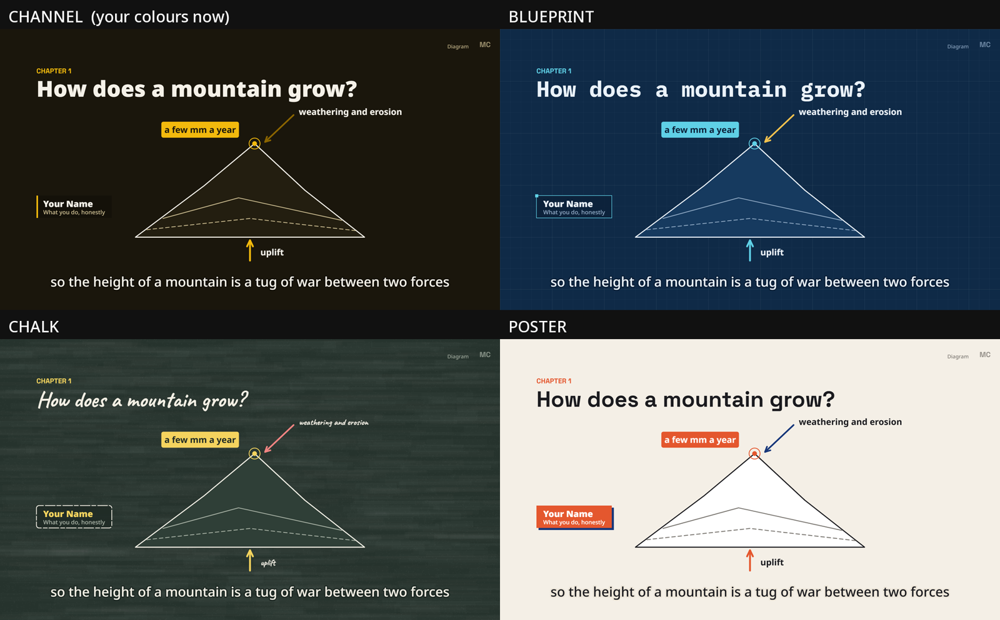

# Explainer Studio

[English](README.md) · **中文**

这是一个 Claude Code 插件，用来做 YouTube 讲解影片。整个制作团队的工作由 Claude 来做，你当导演。你不用写程序，只要决定题目、录自己的声音和出镜片段、看预览、每一步点头或提意见。

它原本是跟中文地球科学频道「金釘子 GoldenSpike」一起做出来的，后来整理成任何题目、任何语言都能用。里面每一条规则，都是从真实影片里做错或做对的事情来的。现在是第 2 版，也就是这条制作流程今天实际在跑的样子（第一次公开的 0.1 版还留着，在 `v0.1.0` 这个标签）。

## 安装和开始：一段话就够

在 Claude Code（终端机、桌面版或 IDE 扩充都可以）里开一个空的资料夹当你的频道资料夹，把下面这段贴进去，最后一行换成你自己的：

```text
帮我安装 Explainer Studio 插件，并把我的影片工作室设好。
1. 在终端机执行：claude plugin marketplace add yuxuanteh/explainer-studio
   接着执行：    claude plugin install explainer-studio@explainer-studio
2. 找到装好的插件资料夹（在 ~/.claude/plugins 底下），读里面的 skills/studio-setup/SKILL.md，一步一步照着做。
   先检查我的电脑，告诉我做一支影片的每个步骤大概要多久。
   要安装或下载任何东西之前，先告诉我它是做什么的、有多大，问我需不需要。
3. 工作室设好之后，先带我跑一次试用范例，然后开始我的第一集。
我的频道：<名字>。用<语言>给<观众>讲<题目>。我做<长片 / 短片 / 两种都做>，<出镜 / 只有旁白>。
```

想自己打指令也可以：`/plugin marketplace add yuxuanteh/explainer-studio`，再 `/plugin install explainer-studio@explainer-studio`，然后说「帮我设好工作室」。

之后都是讲人话：「开新一集，讲……」、「02 的录音放进 raw 了」、「S05 的标签挡到我的手，往左移」、「做成片」。

## 设定的时候会发生什么

1. **先检查你的电脑。** 处理器、内存、显卡、剩下的硬盘空间，再跑两个很短的速度测试。在你决定任何事之前，会先给你一张表：照你平常的影片长度，每个步骤大概要多久。
2. **每一样工具，装之前都先解释、先问你。** 用不到的就跳过，硬盘空间省下来；以后想加，说一句话就可以。
3. **简单问几个问题**：频道名字、观众、语言、你做哪种影片。
4. **看图选风格**：三个范例，跟你现在的样子摆在一起比。
5. **配乐怎么来由你选**：音乐库的曲子、你自己的音乐、Claude 写的程序配乐，或者不要配乐。
6. **试用范例**：一支四句话的短片，从自动剪辑跑到审片页，还没录任何东西就先看到工具长什么样。

### 有哪些部分，谁可以不装

| 部分 | 它帮你做什么 | 什么情况可以不装 | 下载大小 |
|---|---|---|---|
| 核心 | 工作室自己的 Python 和 ffmpeg：剪接、混音、字幕、输出 | 一定要装 | 约 350 MB |
| 字体 | 字幕和画面文字用的免费字体 | 一定要装 | 3 MB（英文等）到 45 MB（中日韩文） |
| 语音识别（Whisper） | 在你自己的电脑上跑，找出你每一个字是什么时候讲的。自动初剪、字幕对时间、整理一整次录音，都靠它 | 你的影片完全没有人声 | 3.1 GB（最准的模型）、1.7 GB（中）或 0.7 GB（小） |
| 动画引擎 | 动画镜头、章节卡、片尾卡、片头、出镜画面上的标签，还有风格比较图 | 你只想把出镜画面剪好、上字幕、混音。这样动画的位置会变成简单的文字卡 | 约 500 MB，另外要装免费的 [motion-showreel](https://github.com/ConardLi/garden-skills) 插件 |
| 配乐对拍 | 把一首曲子照小节线缩短或加长，让它刚好在自己的结尾结束 | 不要配乐，或用程序配乐 | 约 300 MB |
| 程序配乐 | Claude 一个音一个音写出来、用音色库播放的音乐 | 你用音乐库、自己的音乐，或不要配乐 | 约 40 MB，另外要装 FluidSynth |

全部装大约 4.5 GB；最小可用的组合（核心、字体、小的语音模型）大约 1.1 GB。

### 大概要多久

下面是在参考笔电上量的（Intel Core Ultra 7 155H，16 核，16 GB 内存，没有独立显卡），影片是 6 分钟长片加 1 分钟短片。设定时会量你自己的电脑，再照比例换算。

| 步骤 | 电脑要跑多久 |
|---|---|
| 把你讲的话全部写下来（最准的语音模型） | 约 9 分钟 |
| 自动初剪和人声初剪 | 约 3 分钟 |
| 480p 动画版（之后每一轮只重画你提过意见的镜头） | 约 9 分钟 |
| 1080p 成片、短片和字幕档 | 约 13 分钟 |

这些是粗估，实际可能是一半到两倍。有 NVIDIA 显卡的话，语音识别大约快十倍；中型模型在任何电脑上都大约快一倍。你自己的时间（录音、看片、提意见）另外算，Claude 写台本、画动画的时间也另外算。

## 一支影片怎么做出来

一共七步。写着**停**的地方，Claude 会停下来等你点头。

1. **选题。** 跟你发过的影片比对，避免重复。一支影片只讲一个概念。**停。**
2. **台本和配乐候选。** 先找出观众真的会问的问题，再逐条核查事实，然后写一页逻辑稿（**停**），之后照你平常讲话的方式写旁白，另外写一支有自己问题的预告短片，再附上配乐候选让你试听。**停。**
3. **录音包。** 一张录音流程表，告诉你每一条开录前先念什么；道具清单；帮你看相机测试片。然后你录音：旁白和出镜，一次录完。
4. **整理录音、自动初剪、人声初剪。** 你的档案会照你讲的内容自动归位。第一版剪辑先帮你剪好：每一句留最后一次念的，重念和太长的停顿剪掉，字幕对到你讲的字。你在**审片页**看结果、点意见，或者在**剪辑页**自己用耳朵修剪点和字幕。这时候还没做任何动画，怎么改都不花成本。**停。** 你点头之后，时间就锁定了。
5. **480p 动画加配乐。** 每个镜头照你的固定风格、照锁定的时间画出来。你提意见，只重画那几个镜头。**停。**
6. **成片。** 1080p、9:16 短片、翻译字幕。
7. **上传包。** 一页，照平台排好：标题、简介（含章节和参考资料）、标签、片尾画面、置顶留言、短片的文字；缩略图先给你文字想法，你选了再做。**停。** 上传和排程由你自己手动来。

另外还有**批次**（几支影片一起写、同一天录完）、**独立短片**，以及给**新闻短片**的快速通道。

## 每个工具用白话讲

| 工具 | 它是什么 |
|---|---|
| 总闸（`gs_run.py`） | 做任何东西都走这一个入口。它照顺序跑每一项检查，一有问题就停，所以不会因为一个小错白白渲染一次。每一步花了多久它也会记下来 |
| 整理录音（`intake.py`） | 你把一整次录音全部丢进一个资料夹。它会听每一个档案，听出你开头念的编号，归到对的影片和段落 |
| 录音对照（`recording_diff.py`） | 你讲的跟台本比：哪句念了两次、哪句没念到、哪里说法改了、哪个数字不一样 |
| 自动初剪（`gs_cut.py`） | 在录音里找到台本的每一句，留最后一次念的，照音量把剪点放在安静的地方，剪掉重念和长停顿，再把字幕对好时间。最后写一份很短的报告，列出要你听一下的地方 |
| 人声初剪（`gs_voicecut.py`） | 一支很快做出来的影片：剪好的声音、字幕、你真正的出镜画面，动画的位置先放一张简单的卡。做动画之前，你确认的就是这一支 |
| 审片页 | 在你自己电脑上的一个网页。播放、暂停、点一个现成的意见（「停顿太长」、「重念没剪掉」、「字幕有错」……）。每条意见会记下时间、镜头和当时的字幕，Claude 直接读 |
| 剪辑页 | 一个镜头一个镜头看：你录音的波形，亮的是留着的，暗的是剪掉的。拖一段可以剪掉或放回去，镜头的头尾也可以移，字幕可以直接改，太长的打一个 `/` 就断成两句。你在这里存的就是定案，不会被盖掉 |
| 字幕 | 照你的固定风格烧进影片，有两种样子（动画上、出镜画面上）。翻译等你确认剪辑之后才写，会输出成字幕档 |
| 动画引擎（`gs_web.py`） | 每个镜头是一个小网页，给它任何一个时间点，它就画出那一帧；背后有一个看不见的浏览器把每一帧渲染出来。东西会在讲到它的那个字出现 |
| 固定风格（`gs_styles.py`） | 把同一个示范镜头用每一种风格各画一次、并排放，让你看图选 |
| 配乐对拍（`gs_tracks.py`） | 只在小节线上剪，整句整句地拿掉或重复，让曲子停在它自己的结尾，并且压在你的声音底下 |
| 自查（`qa.py`、`review_frames.py`、`check_script.py`） | 每个镜头的缩图总表、听起来不对的停顿和接点、没标来源的镜头、台本长度 |
| 设定工具（`probe.py`、`setup_studio.py`） | 量你的电脑、估时间；安装、检查、移除各个部分 |

## 固定风格

整个频道一个样子：卡片、片头、标签、每个动画镜头的底、字幕，都跟着它走。设定时，同一个示范镜头会画四种给你选：你现在的颜色、三个范例之一，或者 Claude 跟你一起做一个你自己的。



## 从 0.1 版升级

第 2 版是不一样的流程。设定时会把差别一项一项讲给你听、给建议、问你要哪一种：

| 0.1 版 | 第 2 版 | 会问你 |
|---|---|---|
| 每一集自己的配色 | 整个频道一个固定风格 | 留着你的颜色、用范例，还是做一个你自己的 |
| Manim 动画 | 网页动画引擎，Manim 拿掉了 | 还没做完的旧集要不要用新引擎重做 |
| Claude 写的程序配乐 | 由你选 | 继续用程序配乐、改用音乐库或自己的音乐，或不要配乐 |
| 手写剪辑表、480p 才看粗剪 | 自动初剪、人声初剪这一站、审片页和剪辑页 | 用试用范例示范给你看 |
| 三个标题让你选 | 一个标题 | 你发在哪些平台 |
| 网站技能 | 第 2 版没有 | 你的网站照常运作；那个技能在 `v0.1.0` 标签里 |

你的集数、设定、已经下载的语音模型都会留着；旧的程序会先备份。

## 更新、清空间、换电脑、移除

直接跟 Claude 讲就好（「更新 Explainer Studio」、「帮我清硬盘空间」、「我换新电脑了」、「把工作室移除」），设定技能会处理，要删任何东西之前都会先问你。

- **更新：** `claude plugin marketplace update explainer-studio`，再 `claude plugin update explainer-studio@explainer-studio`。你的设定、固定风格、片头和每一集都不会被盖掉：有改动的工具会先备份再换，并且告诉你改了什么。
- **清空间：** 最大的是语音模型（最多 3 GB），可以换成小一点的；渲染暂存随时可以删；任何可选的部分都可以先移除、以后再装。
- **换电脑：** 你的项目资料夹里有台本、录音、影片，还有工作室程序和设定的备份。在新电脑上重新跑一次设定，时间也会重新量。
- **移除：** 删掉工作室资料夹、移除插件。项目资料夹是你的，不会动它。

## 需要什么

- Claude Code 和 Claude 的方案。
- Windows、macOS 或 Linux。在 Windows 11 上做出来、测过；macOS 和 Linux 用的是同一套程序，但用得比较少，可能会遇到一两个小问题。
- 2 到 6 GB 硬盘空间（看你装哪些部分）；内存 8 GB 以上（16 GB 比较宽裕）。
- 一支麦克风，或有麦克风的相机。相机不是必需的。

## 第 2 版还没有的

- 缩略图和上传页的专用工具：这两样目前由 Claude 照文字规则手动做。
- 0.1 版的网站技能。
- 网页和报告有英文和中文两种。旁白可以是语音模型听得懂的任何语言；用得最多的是华语，英文测试过。

## 资料夹怎么分

| 资料夹 | 内容 |
|---|---|
| `skills/studio-setup/` | 设定、检查电脑、各个部分、固定风格、配乐选择、升级、更新、移除 |
| `skills/explainer-episode/` | 七个步骤和它们的参考文件（台本、事实、录音、剪辑、画面、声音、发布、短片、批次、指令） |
| `studio/` | 复制到你本机工作室的工具：`scripts/`、`templates/`、`web/kit/`（动画工具和固定风格）、`requirements/` |
| `channel-template/` | `CHANNEL.md`（你频道的资料和决定）、`CLAUDE.md`、`voice-examples.md`（你怎么讲话） |

你的东西放在两个地方。**项目资料夹**（可以用 Google Drive、Dropbox 之类同步）放台本、录音和做好的影片。**工作室资料夹**留在本机硬盘：工具、Python 环境、语音模型、渲染暂存。

## 授权

这个仓库里的程序和文件是 MIT 授权。`studio/web/kit/motion.js` 来自 motion-showreel 技能（MIT，ConardLi/garden-skills）。其他东西都没有打包进来；设定时经过你同意才下载：faster-whisper（MIT）和它的模型、FFmpeg（LGPL/GPL 版本）、Playwright 和 Chromium、librosa（ISC）、FluidSynth（LGPL）、GeneralUser GS（它自己的免费授权）、Google Fonts 的字体（SIL Open Font Licence）。音乐库的音乐照那个音乐库的授权，由你自己负责。Claude 写的音乐会照实标明。
